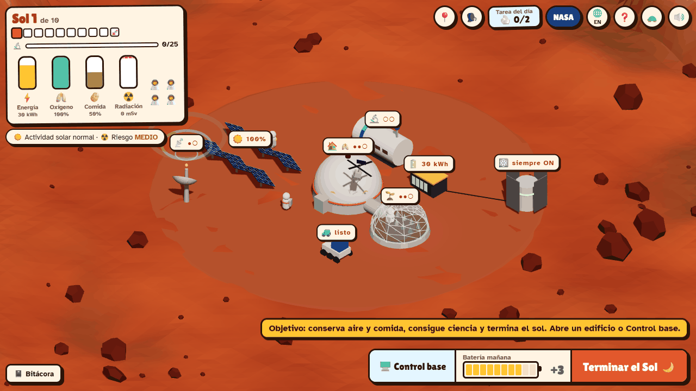
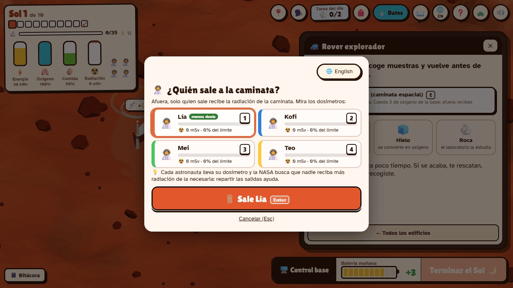
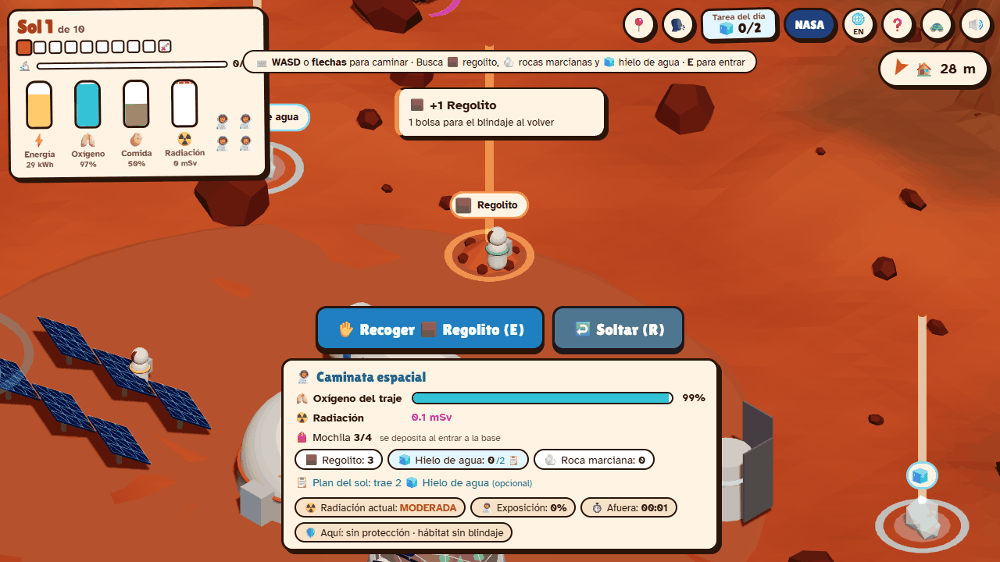
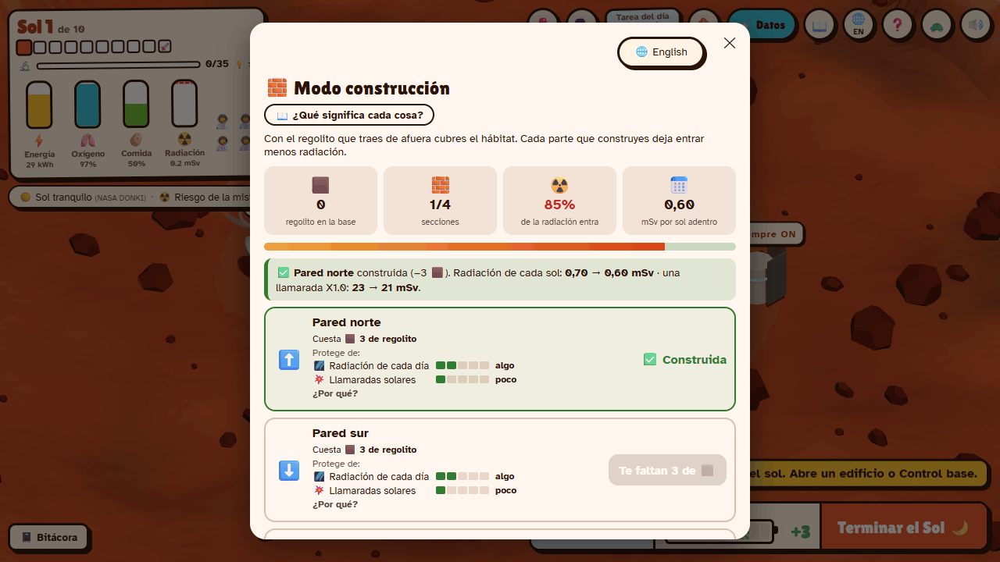
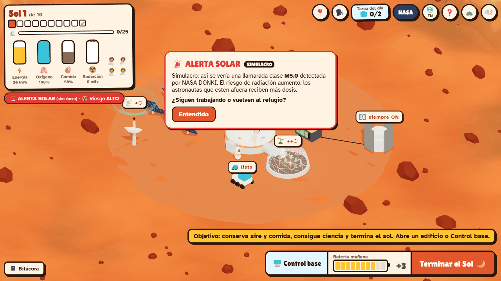
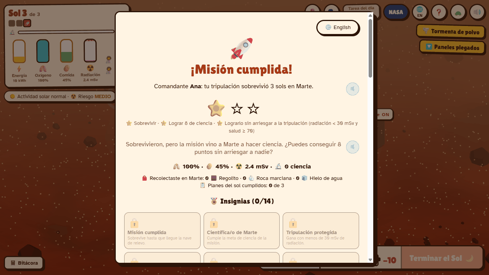

# Survival Mars: Junior Astronaut Mission Trainer

**NASA Space Apps Challenge 2026 · Challenge: *Build a Junior Astronaut Mission Trainer***

### Play now: **https://survival-mars.pages.dev**
Free, in the browser, with no downloads or accounts. Works on computers, tablets and phones.

- **English:** https://survival-mars.pages.dev/?lang=en
- **Judge demo (3 sols, English):** https://survival-mars.pages.dev/?demo=1&lang=en
- **Presentation demo (Spanish):** https://survival-mars.pages.dev/?demo=1&lang=es
- **Solar alert drill (to show the alert):** https://survival-mars.pages.dev/?alerta=1, labelled on screen as a *drill*

Demo mode is labelled on screen, uses a historical DONKI example, gives 30 seconds per emergency and does not save badges.
A normal game offers two ranks, Cadet (10 sols) and Commander (15 sols). The language can be switched at any time without restarting.



| | |
|---|---|
|  |  |
| **Who goes out?** Every astronaut has a dosimeter | **Spacewalk:** suit air, radiation meter and a 4-item backpack |
|  |  |
| **Build mode (B):** every section lowers the radiation | **Solar alert** (drill with `?alerta=1`) |
|  | |
| **End:** stars, badges and mission report | |

---

## What is it about?
Kids aged **7 to 12** command a base on the **NE Syrtis plateau, at the edge of the Isidis basin on Mars**, one of the three finalist landing sites NASA studied for the Perseverance rover.
They must keep their crew alive until the relief ship arrives, making the same kind of hard choices NASA mission planners face. **No decision is free.**

| What players decide | What they learn |
|---|---|
| How to split power between life support, greenhouse, communications and the lab | Power in space is limited |
| Retract the solar panels during a dust storm? | Dust cuts solar power; the Opportunity rover was lost to a global dust storm in 2018. Retractable panels are a game rule. |
| Take shelter or keep working during a scenario based on a **real** solar flare (NASA DONKI)? | Radiation and shielding with regolith; the scenario and doses are simplified |
| How far to walk to collect regolith, water ice or Martian rocks? | Every second outside uses suit air and adds radiation |
| Go back with a full backpack (4 items) or drop something and keep going? | More trips mean more time outside and more radiation |
| Which shielding section to build with the regolith (B key)? | Each section costs bags of regolith and really lowers the radiation inside the habitat |
| Which crew member goes outside? | Each astronaut carries a dosimeter: sharing the walks shares the dose |
| A solar alert arrives: keep working or return to the shelter? | The risk depends on real solar activity (NASA DONKI) |
| Ask Earth for help, which answers late | Messages take minutes to travel: the crew decides on its own |

## Features
- **Isometric 3D world** (Three.js) with day and night, dust storms, astronauts and a rover
- **Guided tutorial** and two ranks: **Cadet** (ages 7 to 9) and **Commander** (ages 10 to 12)
- **Different every game:** the dust storm, solar flares, dust devil and recycler failure fall on different sols each time; the storm is always announced two sols ahead and never overlaps the solar conjunction
- **Science goal that requires risk:** the second and third stars need more power for the lab or spacewalks for rocks; playing it safe only earns one star
- **Playable spacewalk** (keyboard or touch joystick): 4-item backpack, pick up and drop, deposit at the door
- **Spacewalk minimap:** the base, the door and the astronaut, turned so "up" is the W direction. Cadet sees every item; in Commander a suit radar only shows items within 30 m, so players still have to explore
- **Simple spacewalk display:** seconds of suit air left, a single colour radiation meter, backpack slots and the request from Earth; a red screen edge and Geiger-counter clicks warn without reading
- **Build mode (B key):** habitat shielding by sections (north wall, south wall, east and west walls, roof), plus growing beds, a tunnel to the greenhouse and a landing pad for a cargo ship
- **Lab inventions:** every science milestone lets players choose one of two inventions, so science keeps paying off after the goal
- **Opportunities on quiet sols:** a drone flight, a class for a school on Earth, extra exercise, a maintenance check or a birthday; each one has a cost
- **Crew with dosimeters:** Lía, Kofi, Mei and Teo; players choose who goes outside and each one builds up their own dose
- **Solar alert:** Sun indicator always visible and NASA DONKI checked every 10 minutes during the game
- **NE Syrtis world:** layered mesas, olivine, an Ingenuity-style drone and dust devils; light graphics mode for slow computers
- **Countdown emergencies:** dust storms, solar flares, micrometeorites, equipment failures and plant disease
- **Recent NASA DONKI queries**, a cache labelled with its time and a historical fallback; real **NASA OSDR** studies with their source
- **Plan preview:** oxygen, food, science and systems that will lose power, before any new emergency
- Optional three-question review with explanations linked to the player's mission decisions
- **Voice narrator**, mission report with charts and badges
- Works on phones, in portrait and landscape

## Controls
| Action | Keyboard | Phone |
|---|---|---|
| Move the astronaut (spacewalk) | WASD or arrow keys | touch joystick |
| Pick up the nearest item | E or Q | Pick up button |
| Drop an item from the backpack | R | Drop button |
| Deposit and enter the base (at the door) | E | Deposit button |
| Open build mode | B | build button in the habitat panel |
| Choose an option in an emergency or opportunity | 1, 2, 3, 4 | tap the option |
| Continue (next sol, close a result) | Enter | Continue button |
| Close or cancel (never skips a decision) | Esc | close (X) button |

## NASA data
DONKI solar flares (**recent query, cache or historical archive**, always labelled; plus a check every 10 minutes during the game) · Curiosity RAD · OSDR (13 studies: OSD-87, 146, 177, 268, 334, 342, 343, 360, 566, 615, 678, 766, 772) · RadLab ·
NE Syrtis (Mars 2020 finalist site) / Mars Trek · MOXIE · Opportunity · MRO · Solar conjunction · Communication delay.
Full details and simplifications: **[docs/DATOS_NASA.md](docs/DATOS_NASA.md)**.

## Documentation
The documents for judges and teachers are in English. Internal team notes (in Spanish) are kept in `docs/equipo/` and in `docs/PITCH.md`.

| Document | Audience |
|---|---|
| [docs/DATOS_NASA.md](docs/DATOS_NASA.md) | Judges: which NASA data drives each mechanic, and why |
| [docs/GUIA_DOCENTE.md](docs/GUIA_DOCENTE.md) | Teachers: lesson plan, discussion questions and a printable log |
| [docs/VALIDACION.md](docs/VALIDACION.md) | Judges and developers: automated tests, balance check and the pending protocol for testing with children |
| [docs/PITCH.md](docs/PITCH.md) | Team (Spanish): video script and submission text |
| [docs/equipo/](docs/equipo/) | Team (Spanish): challenge analysis and decisions |
| [CLAUDE.md](CLAUDE.md) | Developers (Spanish): code structure |

## Run locally
Nothing to install:
```bash
python -m http.server 5500 --bind 127.0.0.1
# open http://localhost:5500
```
While developing, `python servir.py` does the same but tells the browser not to cache files, so every reload uses the latest code.
Solar flares come from DONKI in this order: the NASA Open APIs flare list, then NASA Open APIs flare notifications (strong flares only, class M5 and above, and the game says so), then the NASA CCMC server, which needs no key. A personal key from https://api.nasa.gov raises the query limit. The cache lasts up to six hours and keeps the original query time. If every source fails, the historical archive is used and labelled as such. The game does not forecast space weather on Mars.

## Testing

No game dependencies to install (Node 22 or later):

```bash
node --test tests/regresiones.mjs tests/mecanicas.mjs tests/guardado.mjs tests/progreso.mjs
```

For the reproducible visual check with Chrome, see [docs/VALIDACION.md](docs/VALIDACION.md).

## For judges

Survival Mars translates NASA data into decisions for ages 7 to 12: spend limited power on life support or science, shelter at the cost of work, and act while waiting for Earth's reply. Open `?demo=1&lang=en` for the three-sol presentation mode. NASA observations inspire the scenarios; the difficulty formula, radiation doses and shielding factors are educational game rules, not a forecast for Mars. The optional final review gives feedback on three trade-offs. Learning gains with real players have not been measured yet.

## Technology
JavaScript (ES modules, no build step) · Three.js (WebGL) · HTML/CSS · Web Speech API (narrator) · Cloudflare Pages.

```
src/sim/      simulation (rules, events, balance)    src/data/   NASA data with sources
src/world3d/  3D world and spacewalk                 src/ui/     interface, tutorial, report, voice
```
